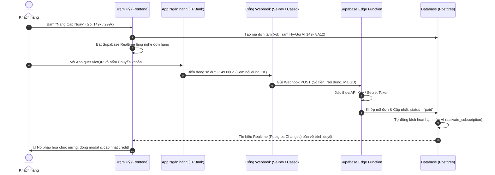

# Hướng Dẫn Tích Hợp Thanh Toán Ngân Hàng Tự Động (VietQR Auto-Webhook)

Tài liệu này hướng dẫn chi tiết quy trình nâng cấp hệ thống thanh toán gói cước AI và dịch vụ của **Trạm Hỷ** từ cơ chế duyệt thủ công sang **tự động hoàn toàn 100%**: Khách chuyển khoản xong, ngân hàng bắn webhook, hệ thống tự động nhận diện, nổ pháo hoa chúc mừng và làm mới quyền lợi của khách tức thì (dưới 3 giây).

---

## 1. Mô Hình Luồng Hoạt Động (Architecture Flow)



---

## 2. Các Giải Pháp Webhook Phổ Biến Tại Việt Nam

| Nền tảng | Hỗ trợ TPBank | Phí duy trì | Ưu điểm | Đánh giá |
| :--- | :---: | :--- | :--- | :---: |
| **SePay.vn** | Có | Miễn phí (bản Free) / Trả phí gói mở rộng | Giao diện thân thiện, API Webhook cực nhanh (1-2s), hỗ trợ tài khoản cá nhân & doanh nghiệp | **Khuyên dùng nhất** |
| **Casso.vn** | Có | Miễn phí tối đa 1 tài khoản | Ổn định, có thư viện SDK Node.js, bắt biến động số dư nhanh | Rất tốt |
| **PayOS.vn** | Có | Miễn phí giao dịch | Tạo mã QR động kèm link thanh toán chuyên nghiệp | Tốt |

---

## 3. Các Bước Triển Khai Chi Tiết

### Bước 1: Đăng ký & Kết nối tài khoản ngân hàng (Ví dụ với SePay)
1. Đăng ký tài khoản tại [sepay.vn](https://sepay.vn).
2. Thêm tài khoản ngân hàng thụ hưởng:
   - Ngân hàng: **TPBank (Tiên Phong Bank)**
   - Số tài khoản: **0355521617**
   - Tên chủ tài khoản: **PHUNG DUC ANH**
3. Cấu hình Webhook URL:
   - URL: `https://<YOUR-PROJECT-ID>.supabase.co/functions/v1/sepay-webhook`
   - Phương thức: `POST`
   - Khóa bí mật (API Key / Authorization Token): Nhập chuỗi bí mật để bảo mật.

---

### Bước 2: Tạo Supabase Edge Function đón Webhook

Tạo function `supabase/functions/sepay-webhook/index.ts`:

```typescript
import { serve } from "https://deno.land/std@0.168.0/http/server.ts";
import { createClient } from "https://esm.sh/@supabase/supabase-js@2";

const SUPABASE_URL = Deno.env.get("SUPABASE_URL")!;
const SUPABASE_SERVICE_ROLE_KEY = Deno.env.get("SUPABASE_SERVICE_ROLE_KEY")!;
const SEPAY_API_KEY = Deno.env.get("SEPAY_API_KEY")!;

const supabase = createClient(SUPABASE_URL, SUPABASE_SERVICE_ROLE_KEY);

serve(async (req) => {
  try {
    // 1. Kiểm tra xác thực Token từ SePay
    const authHeader = req.headers.get("Authorization");
    if (!authHeader || authHeader !== `Apikey ${SEPAY_API_KEY}`) {
      return new Response("Unauthorized", { status: 401 });
    }

    const body = await req.json();
    // Cấu trúc dữ liệu SePay gửi về:
    // {
    //   "id": 123456,
    //   "gateway": "TPBank",
    //   "transactionDate": "2026-10-28 23:00:00",
    //   "accountNumber": "0355521617",
    //   "code": null,
    //   "content": "Tram Hy-Goi AI 149k 8A12",
    //   "transferType": "in",
    //   "transferAmount": 149000
    // }

    const { content, transferAmount, transferType } = body;
    if (transferType !== "in") {
      return new Response(JSON.stringify({ message: "Bỏ qua giao dịch tiền ra" }), { status: 200 });
    }

    // 2. Tìm mã đơn hàng từ nội dung chuyển khoản
    // Format: "Trạm Hỷ-Gói AI {price}k {code}" hoặc không dấu
    const match = content.match(/[A-Z0-9]{4}$/i); // Bắt hậu tố 4 ký tự cuối
    if (!match) {
      return new Response(JSON.stringify({ message: "Không tìm thấy mã đơn trong nội dung" }), { status: 200 });
    }

    // 3. Khớp đơn trong bảng subscription_orders
    const { data: order, error: orderErr } = await supabase
      .from("subscription_orders")
      .select("*")
      .ilike("code", `%${match[0]}%`)
      .eq("status", "pending")
      .maybeSingle();

    if (!order) {
      return new Response(JSON.stringify({ message: "Đơn không tồn tại hoặc đã xử lý" }), { status: 200 });
    }

    // Kiểm tra số tiền chuyển có khớp với giá trị gói không
    if (transferAmount < order.amount) {
      // Ghi chú nhận thiếu tiền
      await supabase.from("subscription_orders").update({
        notes: `Khách chuyển thiếu tiền: Đã nhận ${transferAmount}/${order.amount}`
      }).eq("id", order.id);
      return new Response(JSON.stringify({ message: "Số tiền chuyển chưa đủ" }), { status: 200 });
    }

    // 4. Kích hoạt gói cước cho khách thông qua RPC
    const { data: activated, error: actErr } = await supabase.rpc("admin_confirm_subscription_order", {
      p_order_code: order.code
    });

    if (actErr) throw actErr;

    return new Response(JSON.stringify({ success: true, order_id: order.id }), {
      status: 200,
      headers: { "Content-Type": "application/json" }
    });
  } catch (err) {
    return new Response(JSON.stringify({ error: err.message }), { status: 500 });
  }
});
```

---

### Bước 3: Cấu hình Frontend tự động nhận diện Realtime

Trong file [frontend/js/components/pricing-modal.js](file:///d:/exe202/frontend/js/components/pricing-modal.js), tại hàm `renderQrView(order)`:

```javascript
// Lắng nghe realtime sự thay đổi trạng thái của đơn hàng này
const orderChannel = sb
  .channel(`order-paid-${order.code}`)
  .on(
    'postgres_changes',
    {
      event: 'UPDATE',
      schema: 'public',
      table: 'subscription_orders',
      filter: `code=eq.${order.code}`,
    },
    (payload) => {
      // Khi Webhook cập nhật status = 'paid'
      if (payload.new && payload.new.status === 'paid') {
        orderChannel.unsubscribe();
        // Tự động chuyển màn hình thành công & nổ pháo hoa
        renderSuccessView({
          plan_name: order.plan.name,
          daily_credits: order.plan.daily_credits,
          bonus_credits: order.plan.bonus_credits,
        });
      }
    }
  )
  .subscribe();

// Đảm bảo hủy kênh lắng nghe khi người dùng bấm quay lại hoặc đóng modal
body.querySelector('[data-back-to-plans]')?.addEventListener('click', () => {
  sb.removeChannel(orderChannel);
  renderPlansView();
});
```

---

## 4. Trải Nghiệm Khách Hàng Khi Đã Tích Hợp

1. **Khách bấm "Nâng cấp ngay":**
   - Modal hiển thị mã VietQR kèm số tiền và nội dung chuyển khoản tự động.
   - Bên dưới có biểu tượng radar xoay nhẹ: `Đang chờ nhận chuyển khoản...`
2. **Khách thực hiện quét mã trên điện thoại:**
   - Khách bấm xác nhận chuyển tiền trên app TPBank / MB / Vietcombank.
3. **Phản hồi tức thì trên máy tính / điện thoại:**
   - Trong vòng **1 – 3 giây**, màn hình chuyển khoản tự động đóng lại.
   - Pháo hoa `confetti` nổ rực rỡ, thông báo: **"Nâng Cấp Thành Công! Hạn mức đã tăng lên 60/150 credit/ngày"**.
   - Hạn mức trên thanh công cụ cập nhật ngay mà khách **không cần phải bấm bất kỳ nút nào hay tải lại trang thủ công**.

---

## 5. Danh Sách Kiểm Tra Khi Bắt Đầu Làm (Checklist)

- [ ] Đăng ký tài khoản tại cổng kết nối (SePay hoặc Casso).
- [ ] Thêm số tài khoản nhận tiền **TPBank 0355521617 (PHUNG DUC ANH)**.
- [ ] Tạo Supabase Edge Function `sepay-webhook` và nạp biến môi trường `SEPAY_API_KEY`.
- [ ] Cập nhật bảng `subscription_orders` bật quyền Realtime (`REPLICA IDENTITY FULL`).
- [ ] Gắn mã lắng nghe `postgres_changes` vào `pricing-modal.js`.
- [ ] Thử nghiệm chuyển khoản thực tế 10.000đ hoặc 149.000đ để kiểm tra tốc độ phản hồi.
