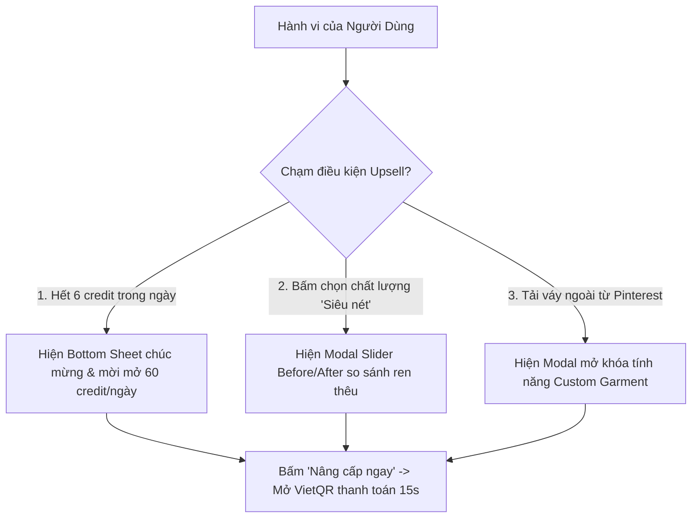
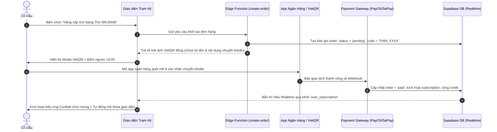

# KẾ HOẠCH TRIỂN KHAI CÁC GÓI CƯỚC AI THỬ ĐỒ CƯỚI (AI BRIDAL STUDIO)
**Dự án:** Nền tảng Công nghệ Cưới hỏi Trạm Hỷ  
**Phiên bản tài liệu:** 1.0  
**Ngày lập:** Tháng 10/2026  
**Mục tiêu:** Mở rộng hạn mức AI, tăng trưởng doanh thu (Monetization), tối ưu chi phí vận hành GPU/API và nâng tầm trải nghiệm người dùng chuẩn SaaS quốc tế kết hợp phong cách Bridal Luxury.

---

## MỤC LỤC
1. [Bối Cảnh & Phân Tích Hành Vi Khách Hàng](#1-bối-cảnh--phân-tích-hành-vi-khách-hàng)
2. [Chi Tiết 3 Gói Cước AI (Tiering & Packaging)](#2-chi-tiết-3-gói-cước-ai-tiering--packaging)
3. [Ma Trận Tính Năng So Sánh (Feature Matrix)](#3-ma-trận-tính-năng-so-sánh-feature-matrix)
4. [Thiết Kế Trải Nghiệm Người Dùng (UX/UI Specification)](#4-thiết-kế-trải-nghiệm-người-dùng-uxui-specification)
5. [Điểm Kích Hoạt Nâng Cấp Thông Minh (Smart Upsell Triggers)](#5-điểm-kích-hoạt-nâng-cấp-thông-minh-smart-upsell-triggers)
6. [Luồng Thanh Toán VietQR Tự Động (Instant Payment Flow)](#6-luồng-thanh-toán-vietqr-tự-động-instant-payment-flow)
7. [Kiến Trúc Dữ Liệu & Backend Supabase (System Architecture)](#7-kiến-trúc-dữ-liệu--backend-supabase-system-architecture)
8. [Lộ Trình Triển Khai Từng Bước (Implementation Roadmap)](#8-lộ-trình-triển-khai-từng-bước-implementation-roadmap)

---

## 1. BỐI CẢNH & PHÂN TÍCH HÀNH VI KHÁCH HÀNG

### 1.1. Hiện Trạng Hệ Thống AI Hiện Tại
- Hệ thống AI thử váy cưới tại Trạm Hỷ hiện đang giới hạn mặc định **6 credit/người/ngày** (reset lúc 00:00 giờ Việt Nam).
- Với mỗi lần tạo ảnh:
  - Chế độ tiêu chuẩn (Standard): tốn 1 credit/ảnh.
  - Chế độ Siêu nét 1K (FASHN Max): tốn 1–3 credit/ảnh tùy độ chi tiết (`fast: 1`, `balanced: 2`, `quality: 3`).
- **Nút thắt (Bottleneck):** Người dùng chỉ thử được 2 đến 6 ảnh là hết hạn mức ngày. Nhiều cô dâu đang trong giai đoạn hào hứng chọn váy cưới thì bị ngắt quãng, tạo ra sự ức chế và bỏ lỡ cơ hội chuyển đổi thương mại cho nền tảng.

### 1.2. Đặc Thù Ngành Cưới (Bridal Tech vs SaaS Thông Thường)
- **Chu kỳ "Cửa sổ chuẩn bị cưới" (Wedding Window):** Kéo dài từ **1 đến 3 tháng cao điểm**. Khác với dịch vụ stream nhạc/phim (người dùng trả phí cả năm), cô dâu chú rể chỉ có nhu cầu bùng nổ trong vài tháng này.
- **Tâm lý sẵn sàng chi trả (Willingness to Pay):** Trong tổng chi phí chuẩn bị cưới từ 80 đến 300 triệu đồng, một khoản phí từ **99.000đ đến 249.000đ** là cực kỳ nhỏ bé (chỉ bằng tiền 1–2 cốc trà sữa), miễn là giải quyết được bài toán:
  - Thử được nhiều kiểu dáng váy/vest tại nhà trước khi đi tiệm thử thực tế.
  - Ảnh phải đủ nét, chi tiết ren thêu sắc sảo để khoe gia đình, bạn bè hoặc gửi tiệm may.
  - Thử được cả các mẫu váy họ tự tìm trên Pinterest, Instagram hoặc TikTok.

---

## 2. CHI TIẾT 3 GÓI CƯỚC AI (TIERING & PACKAGING)

Chiến lược định giá áp dụng nguyên lý **Neo giá tâm lý (Price Anchoring)** và **Gói chim mồi (Decoy Effect)**:

```
[ Gói 1: Khởi Điểm ]         [ Gói 2: Nàng Thơ Rạng Rỡ ⭐ ]         [ Gói 3: Cẩm Tú Trọn Đôi 👑 ]
      0đ / mãi mãi                   99.000đ / 30 ngày                     249.000đ / 60 ngày
   (Phễu trải nghiệm)             (Gói chủ lực - 85% chọn)              (Gói cao cấp cho cặp đôi)
```

### 2.1. Gói 1: Khởi Điểm (Basic / Nàng Thơ Trải Nghiệm)
- **Mức giá:** `0đ` (Miễn phí vĩnh viễn khi đăng ký tài khoản).
- **Hạn mức:** **6 credit / ngày** (reset lúc 00:00).
- **Mục tiêu:** Tạo phễu thu hút (Product-Led Growth), cho người dùng thấy kết quả kỳ diệu ngay trong lần đầu tiên mà không có bất kỳ rào cản nào.
- **Giới hạn kỹ thuật:**
  - Chỉ dùng mô hình tiêu chuẩn (Standard 768p).
  - Tải tối đa 3 ảnh người mẫu cá nhân.
  - Chỉ thử váy có sẵn trong bộ sưu tập của Trạm Hỷ.
  - Hàng đợi thông thường (thời gian tạo 15–25s).
  - Ảnh có watermark nhỏ "Trạm Hỷ AI".

### 2.2. Gói 2: Nàng Thơ Rạng Rỡ (Pro Bride) ⭐ *(Gói Khuyên Dùng)*
- **Mức giá:** **`99.000đ` / 30 ngày** (tương đương chỉ ~3.300đ/ngày).
- **Hạn mức hàng ngày:** **60 credit / ngày** (gấp 10 lần gói thường, thỏa sức tạo 20–60 ảnh/ngày).
- **Thưởng kích hoạt:** Tặng ngay **+30 credit linh hoạt** vào ví để thử tẹt ga ngay trong ngày đầu tiên.
- **Quyền lợi độc quyền:**
  - **Mở khóa chế độ Siêu Nét 1K Ultra HD** (FASHN Max / Gemini High Quality): Phục dựng chi tiết ren, vải voan xuyên thấu, hạt pha lê lấp lánh sắc sảo.
  - **Tự do tải váy ngoài:** Thử bất kỳ ảnh váy nào tải từ Pinterest, TikTok, Facebook (không giới hạn trong kho tiệm).
  - **Lưu trữ ảnh cá nhân:** Tối đa 15 ảnh với nhiều góc đứng, kiểu tóc và dáng người.
  - **Hàng đợi ưu tiên (Fast-pass Queue):** Xử lý ưu tiên, trả ảnh nhanh trong 8–12 giây.
  - **Xóa sạch Watermark:** Tải ảnh sắc nét, sạch đẹp lưu làm kỷ niệm hoặc chia sẻ mạng xã hội.

### 2.3. Gói 3: Cẩm Tú Trọn Đôi (VIP Studio & Duo Pass) 👑
- **Mức giá:** **`249.000đ` / 60 ngày** (trọn gói 2 tháng cao điểm mùa cưới).
- **Hạn mức hàng ngày:** **150 credit / ngày** (Fair Use) + Tặng ngay **+100 credit linh hoạt**.
- **Đối tượng:** Cặp đôi kỹ tính, cô dâu chuẩn bị nhiều lễ (Lễ hỏi, Lễ vu quy, Tiệc cưới), hoặc Wedding Stylist / Studio ảnh cưới tư vấn cho khách.
- **Quyền lợi đỉnh cao:**
  - **Tính năng Thử Đôi (Bride & Groom Duo AI):** Ướm đồng thời cả váy cô dâu và vest/áo dài chú rể trong cùng một khung hình.
  - **Trợ lý AI Stylist Chuyên Sâu (VIP Fashion Consultant):** Phân tích hình thể (dáng quả lê, đồng hồ cát, chữ nhật...), tư vấn tone màu váy theo Personal Color và địa điểm tổ chức tiệc (bãi biển, ballroom khách sạn, sân vườn ngoài trời).
  - **Xuất ảnh gốc độ phân giải cao:** Hỗ trợ tính năng Upscale phục vụ in thiệp cưới hoặc phóng ảnh album.
  - Lưu trữ không giới hạn bộ sưu tập trang phục & ảnh mẫu.
  - Kênh hỗ trợ ưu tiên 1:1 qua Zalo VIP.

---

## 3. MA TRẬN TÍNH NĂNG SO SÁNH (FEATURE MATRIX)

| Tiêu chí | Gói Khởi Điểm (0đ) | Gói Nàng Thơ Rạng Rỡ (99k) ⭐ | Gói Cẩm Tú Trọn Đôi (249k) 👑 |
| :--- | :---: | :---: | :---: |
| **Giá thanh toán** | 0đ | 99.000 đ | 249.000 đ |
| **Thời gian hiệu lực** | Vĩnh viễn | 30 ngày | 60 ngày |
| **Hạn mức Credit/ngày** | 6 credit | 60 credit | 150 credit |
| **Credit tặng kèm khi kích hoạt** | 0 | +30 credit | +100 credit |
| **Chất lượng ảnh** | Tiêu chuẩn (768p) | Siêu nét 1K Ultra HD | Siêu nét 1K & 2K Retouch |
| **Ưu tiên tốc độ xử lý** | Bình thường (15-25s) | Nhanh (8-12s) | VIP Tức thì (<8s) |
| **Thử váy ngoài (Pinterest/Web)** | ❌ Không hỗ trợ | ✅ Không giới hạn | ✅ Không giới hạn |
| **Thử đồng thời Vest & Váy Đôi** | ❌ Không hỗ trợ | ❌ Không hỗ trợ | ✅ Mở khóa độc quyền |
| **Số ảnh người mẫu lưu trữ** | 3 ảnh | 15 ảnh | Không giới hạn |
| **Watermark Trạm Hỷ** | Có đóng dấu mờ | ❌ Đã xóa sạch | ❌ Đã xóa sạch |
| **Trợ lý AI Stylist cá nhân** | Cơ bản | Gợi ý theo dáng người | Phân tích sâu theo Personal Color |
| **Hỗ trợ khách hàng** | Cộng đồng | Hỗ trợ ưu tiên | Chăm sóc riêng 1:1 qua Zalo |

---

## 4. THIẾT KẾ TRẢI NGHIỆM NGƯỜI DÙNG (UX/UI SPECIFICATION)

Tuân thủ nghiêm ngặt quy tắc giao diện **Soft Luxury / Bridal Tech** theo `AGENTS.md`:
- **Bảng màu:** Đỏ đô thương hiệu (`--brand: #9b2335`), Nền kem ấm (`--bg: #faf5ef`), Viền mảnh sang trọng (`--line: #e8ded4`), Chữ nâu trầm (`--ink: #2a2421`).
- **Typography:**
  - Tiêu đề dùng font `Playfair Display`, bật `text-wrap: balance` tránh rớt chữ lẻ.
  - Các con số giá tiền (`99.000 đ`, `249.000 đ`), phần trăm (`%`), ngày đếm ngược bắt buộc sử dụng `font-variant-numeric: tabular-nums` để canh cột ngay ngắn.
- **Bố cục Thẻ giá (Pricing Cards Layout):**
  - **Thẻ trung tâm (Gói Nàng Thơ):** Được thiết kế là "Hero Card", kích thước nổi bật hơn, viền vàng ánh kim nhạt (`#d4af37`), đổ bóng tinh tế `box-shadow: 0 16px 36px rgba(155, 35, 53, 0.12)`.
  - Phía trên có badge đính kèm: *"Được 89% Cô dâu lựa chọn"*.
  - Nút CTA chính phủ màu đỏ nhung có hiệu ứng phản chiếu ánh sáng (Shimmer Light Sweep) chạy qua mỗi 4 giây.
- **Phản hồi xúc giác & Chuyển động (Emil Kowalski):**
  - Thời lượng hoạt ảnh từ 180ms – 250ms với đường cong giảm tốc tự nhiên `cubic-bezier(0.22, 1, 0.36, 1)`.
  - Khi người dùng nhấn nút (`:active`), thẻ thu nhẹ `transform: scale(0.98)` đem lại cảm giác cao cấp.

---

## 5. ĐIỂM KÍCH HOẠT NÂNG CẤP THÔNG MINH (SMART UPSELL TRIGGERS)

Người dùng không tự tìm đến trang bảng giá trừ khi họ gặp rào cản đúng lúc cảm xúc đang cao trào:



1. **Trigger 1 – Khi chạm trần 6 credit:**
   - Thay vì báo lỗi khô khan: *"Bạn đã hết credit, vui lòng quay lại ngày mai"*, hệ thống mở một Bottom Sheet mềm mại:
   > *"Hôm nay bạn đã ướm thử rất xuất sắc! Đừng để nguồn cảm hứng ngắt quãng — Mở khóa ngay **60 credit/ngày** và chế độ **Siêu Nét 1K** để tiếp tục chọn chiếc váy mơ ước."*
   > `[ Nâng Cấp Gói Nàng Thơ – Chỉ 99.000đ ]`
2. **Trigger 2 – Khi người dùng bấm thử chế độ "Siêu Nét 1K":**
   - Hiện thanh trượt so sánh ảnh tương tác (Before/After Slider): Kéo sang trái thấy ảnh thường 768p, kéo sang phải thấy ảnh Siêu nét thấy rõ từng hạt cườm đính và hoa văn thêu.
3. **Trigger 3 – Khi bấm tải váy cá nhân:**
   - Thông báo tính năng ướm thử mọi mẫu váy cưới tự chọn trên thế giới độc quyền cho gói Nàng Thơ & Cẩm Tú.

---

## 6. LUỒNG THANH TOÁN VIETQR TỰ ĐỘNG (INSTANT PAYMENT FLOW)

Không yêu cầu nhập thẻ tín dụng phức tạp, 100% người dùng Việt Nam đều quen thuộc với thao tác quét mã ngân hàng:



- **Thời gian xử lý:** Trung bình từ **3 đến 5 giây** sau khi người dùng bấm chuyển tiền trên app ngân hàng.
- **Trải nghiệm liền mạch:** Màn hình tự động chuyển trạng thái thành công, số credit trên thanh bar nhảy ngay từ `0` lên `60 credit` mà **không cần tải lại trang (No page reload)**.

---

## 7. KIẾN TRÚC DỮ LIỆU & BACKEND SUPABASE (SYSTEM ARCHITECTURE)

Thiết kế file migration mới `35_subscription_tiers.sql` tương thích hoàn toàn với kiến trúc hiện có (`app_settings`, `profiles`, `tryon_jobs`, `reserve_tryon_credits`):

### 7.1. Bảng Gói Cước (`subscription_plans`)
```sql
create table if not exists public.subscription_plans (
  id text primary key, -- 'basic', 'pro_bride', 'studio_duo'
  name text not null,
  price int not null default 0,
  duration_days int not null default 30,
  daily_credits int not null default 6,
  bonus_credits int not null default 0,
  max_saved_photos int not null default 3,
  allow_own_garment boolean not null default false,
  allow_max_quality boolean not null default false,
  badge text,
  created_at timestamptz not null default now()
);

-- Khởi tạo dữ liệu 3 gói
insert into public.subscription_plans (id, name, price, duration_days, daily_credits, bonus_credits, max_saved_photos, allow_own_garment, allow_max_quality, badge)
values
  ('basic', 'Khởi Điểm', 0, 3650, 6, 0, 3, false, false, null),
  ('pro_bride', 'Nàng Thơ Rạng Rỡ', 99000, 30, 60, 30, 15, true, true, 'Khuyên Dùng'),
  ('studio_duo', 'Cẩm Tú Trọn Đôi', 249000, 60, 150, 100, 999, true, true, 'VIP Studio')
on conflict (id) do nothing;
```

### 7.2. Bảng Đăng Ký Của Người Dùng (`user_subscriptions`)
```sql
create table if not exists public.user_subscriptions (
  id uuid primary key default gen_random_uuid(),
  user_id uuid not null references public.profiles(id) on delete cascade,
  plan_id text not null references public.subscription_plans(id),
  bonus_balance int not null default 0,
  starts_at timestamptz not null default now(),
  expires_at timestamptz,
  status text not null default 'active' check (status in ('active', 'expired', 'cancelled')),
  created_at timestamptz not null default now()
);

create index if not exists idx_user_subscriptions_user_status on public.user_subscriptions(user_id, status);
```

### 7.3. Cải Tiến Hàm Giữ Chỗ Credit (`reserve_tryon_credits`)
Trong migration hiện tại (`34_tryon_credit_hold.sql`), hàm lấy `p_limit` truyền từ Edge Function. Ta tối ưu lại để Edge Function đọc hạn mức gói hiện tại của người dùng:
1. Kiểm tra xem người dùng có gói đăng ký nào đang ở trạng thái `active` và `expires_at > now()` hay không.
2. Nếu có, hạn mức ngày = `plan.daily_credits` (ví dụ: 60 hoặc 150) thay vì mức 6 mặc định.
3. Nếu credit ngày đã hết, tự động trừ vào `bonus_balance` trước khi từ chối yêu cầu.

---

## 8. LỘ TRÌNH TRIỂN KHAI TỪNG BƯỚC (IMPLEMENTATION ROADMAP)

### Giai đoạn 1: Thiết Kế UI/UX & Giao Diện Bảng Giá (Frontend)
- **Tạo Component `pricing-modal.js`:** Thiết kế modal/sheet so sánh 3 gói cước theo phong cách Bridal Luxury.
- **Thanh trạng thái trên Phòng thử đồ (`tryon.js`):** Bổ sung nút nâng cấp gói cạnh số credit: `[ 6/6 credit • Nâng Cấp ⭐ ]`.
- **Dựng Bottom Sheet cảnh báo hết credit:** Kích hoạt thông báo tinh tế khi `cost > remaining`.

### Giai đoạn 2: Cài Đặt CSDL & Edge Function (Backend Supabase)
- Viết file migration `35_subscription_tiers.sql`.
- Tạo Edge Function `create-subscription-order` (sinh mã đơn và link ảnh VietQR).
- Tạo Edge Function `payment-webhook` để nhận tín hiệu thanh toán từ cổng thanh toán.

### Giai đoạn 3: Tích Hợp Cổng Thanh Toán & Realtime
- Kết nối dịch vụ VietQR / PayOS tự động.
- Lắng nghe sự kiện `INSERT/UPDATE` trên bảng `user_subscriptions` qua Supabase Realtime để mở khóa ngay trên giao diện client.

### Giai đoạn 4: Mở Khóa Tính Năng & Kiểm Thử Toàn Diện
- Mở cờ cho phép chọn chất lượng Siêu Nét và tải váy ngoài khi tài khoản thuộc gói `pro_bride` hoặc `studio_duo`.
- Kiểm thử đa thiết bị (Desktop & Mobile 390px) đảm bảo không giật lag, không tràn ngang layout.

---
*Tài liệu được lưu trữ trực tiếp tại `d:\exe202\docs\KE_HOACH_GOI_CUOC_AI_STUDIO.md` để phục vụ phát triển kỹ thuật và bàn giao dự án.*
